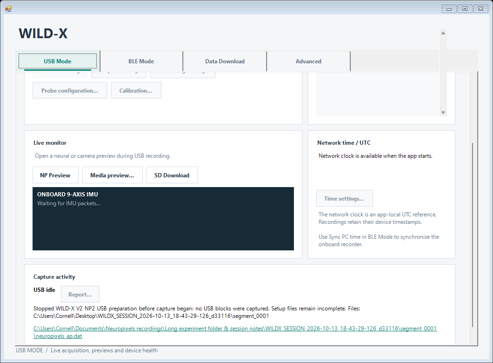

# Recording info layout fix - WILDX 1.0.0.13

The Capture activity card previously assigned a fixed row to the output file
link and the remaining fixed card space to recording status. Long preparation,
error or recording messages and paths were clipped. Both labels now wrap with
ellipsis disabled. Their preferred text heights determine the row and card
heights; text, font and window-size changes refresh the layout. The USB page
retains its scaled minimum live-monitor area and scrolls when needed. Short
messages shrink the card again. Ampersands in paths remain literal text.

The GUI build used private output/intermediate paths and cached component-only
targets. The final build had zero warnings/errors. No helper, companion, SDK
or firmware was rebuilt. Existing pending SR/IMU sensor source files and
production GUI/exporter outputs were hashed before/after and remained
unchanged; their source integration remains with the sensor owner. This release
commits only the layout/version changes and their package documentation.

The exact app passed 60 offscreen checks with long status/path text, explicit
line breaks, an unbroken long path, normal/minimum widths, 150%/200% geometry
and enlarged fonts, non-overlapping rows, retained telemetry space and shrink
after returning to idle. The existing 294 standalone checks also passed.
Rendering reparented controls into an offscreen host and did not invoke the
main window Load/Shown handlers, device discovery or hardware commands.
Private render/check evidence is under
`_artifacts/recording_info_layout_20261013`.

The existing NSIS recipe produced
`LATEST_INSTALLERS/WILDX_console-Setup-1.0.0.13.exe` (2,304,049 bytes), SHA-256
`032E786EC0F402CC0F6E9861007D4F05E9B5E22084F790EEC8ABBAF51185024B`.
GUI SHA-256 is
`9152A8862D1815EF3F19D293F71562A0691910D85740B1B22C358B90AC7A1B50`.
All 13 runtime files were independently extracted with 7-Zip and matched the
payload. The twelve non-GUI runtime files match the previous published SR/IMU
package. Its installer, checksums and manifest are preserved under
`LATEST_INSTALLERS/legacy/20261013_before_recording_info_1.0.0.13`.

The retained firmware baseline is recovery `6408DBB8`, USB `BFF0A8A2` and
logger `E07FB882`. Earlier short SR/IMU hardware evidence applies to GUI
`53E5AFDB5A4C238C7A1AAC8C80F86C63D716B57F55BD1D0E4CD052C78FD9963B`;
it was not repeated for this layout-only revision. Accelerometer/gyro evidence
remains six-axis; magnetometer error 9 and prior recording/recovery limits
remain. This run did not install/uninstall the app or qualify physical
transport, endurance, firmware updates or a new firmware/app pair.
